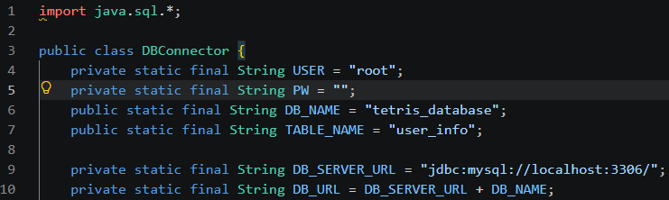

# Capstone_Tetris

## 목차
- [1. 프로젝트 소개](#1-프로젝트-소개)
- [2. 주요 기능](#2-주요-기능)
- [3. 사용 기술](#3-사용-기술)
- [4. 설치 및 실행 방법](#4-설치-및-실행-방법)
- [5. 조작법](#5-조작법)

### 1. 프로젝트 소개


### 2. 주요 기능


### 3. 사용 기술

---

### 4. 설치 및 실행 방법

본문에서 설명하는 설치 및 실행 방법은 다음과 같은 사용자 환경을 요구합니다.<br>

**.** Windows 환경<br>
**·** JDK가 설치된 환경<br>
**·** MySQL이 설치되어 실행 중인 환경<br>

설명에 앞서 해당 프로그램은 클라이언트와 서버는 같은 PC에서 실행해야 합니다.

---
<br>

1\. 프로젝트 폴더 다운로드

\- git이 설치된 환경에서는 다음 명령어를 이용하여 다운로드 할 수 있습니다.<br>

```cmd
git clone --depth 1 https://github.com/CodingDooPal/Capstone_Tetris.git
```

\- 만약 git이 설치된 환경이 아니라면 저장소 페이지의 `Code -> Download ZIP`을 하면 다운로드가 가능합니다.

---

2\. 데이터베이스 연결 설정

다운로드 받은 폴더의 다음 경로로 들어가 `DBConnector.java`라는 이름의 파일을 엽니다.

`Capstone_Tetris\TetrisServer\DBConnector.java` 파일을 엽니다.

<br>

- `PW` 변수에 자신의 MySQL ROOT 패스워드를 입력하시면 됩니다.
- 추가적으로 MySQL이 3306이 아닌 다른 PORT를 사용 중이라면 `DB_SERVER_URL` 변수에서 PORT 번호를 변경하면 됩니다.

+) 수정된 코드를(비밀번호가 노출된 채로) 다른 곳에 올라가지 않도록 주의하세요.

---

3\. 서버 실행

cmd에서 다운로드 받은 TetrisServer 폴더의 경로로 이동합니다. 이후 아래의 명령어를 입력하여 서버를 컴파일 후 실행할 수 있습니다.<br>

\- 폴더 경로<br>
`Capstone_Tetris\TetrisServer>`

\- 서버 컴파일 및 실행 명령어

```cmd
:: 컴파일 명령어
javac -cp ".;lib/mysql-connector-j-26.7.0.jar" *.java

:: 실행 명령어
java -cp ".;lib/mysql-connector-j-26.7.0.jar" TetrisServer
```

---

4\. 클라이언트 실행

해당 과정은 서버가 실행된 상태에서 진행합니다.

다른 cmd 창에서 다운로드 받은 TetrisClient폴더의 .\src 경로로 이동합니다. 이후 아래의 명령어를 입력하여 클라이언트를 컴파일 후 실행할 수 있습니다.

\- 폴더 경로<br>
`Capstone_Tetris\TetrisClient\src>`

\- 클라이언트 컴파일 및 실행 명령어

```cmd
:: 컴파일 명령어
javac *.java

:: 실행 명령어
java TetrisClientMain
```

---

5\. 회원가입 후 로그인

마지막으로 회원가입 후 로그인을 진행하면 됩니다. 회원 정보는 localhost에 위치한 MySQL 서버에 저장이 됩니다. 또한 회원가입 과정에서 개인정보는 전혀 사용하지 않기 때문에 부담없이 진행하시면 됩니다.

6\. 실행이 안 될 때

확인해야 할 거 적어야 됨.


### 5. 조작법
